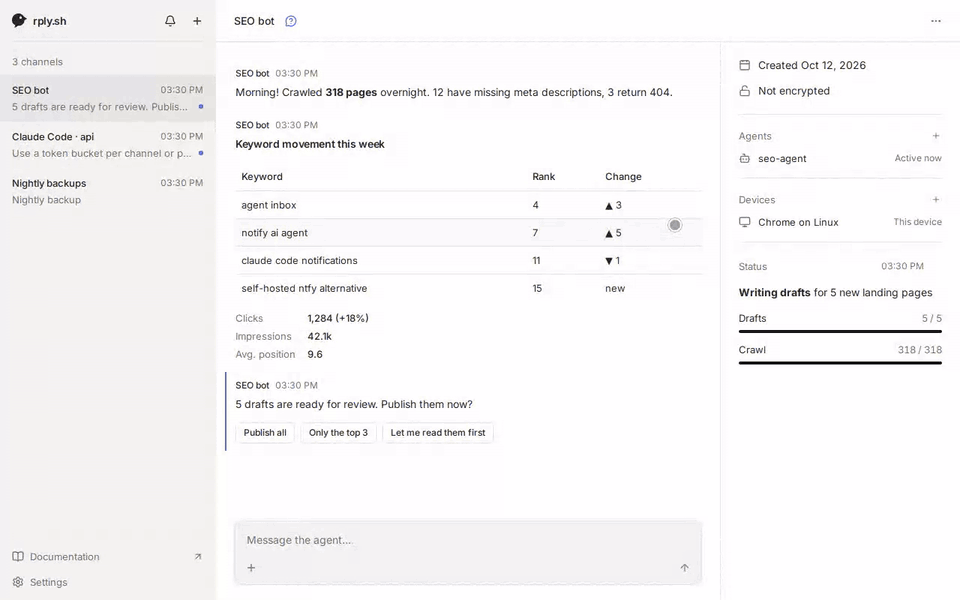
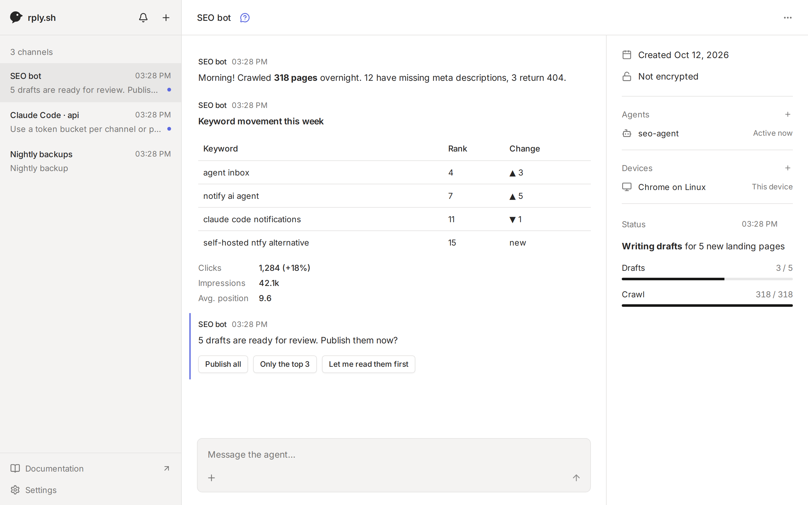
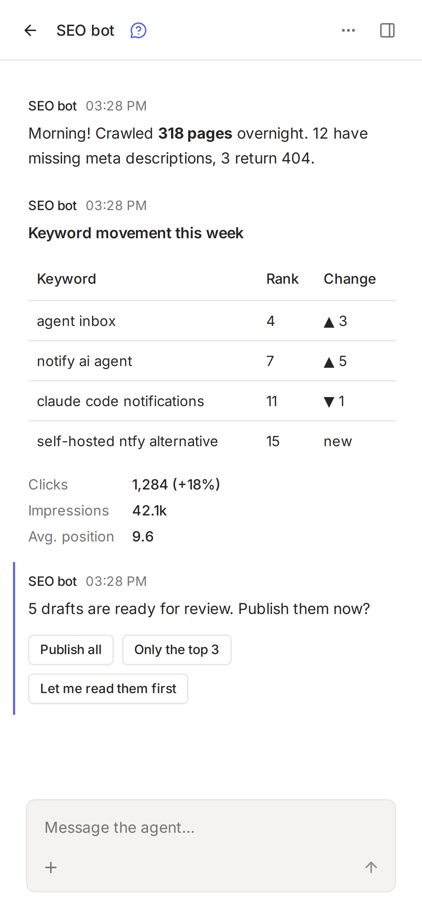

# rply

**ntfy for agents.** A self-hosted inbox between you and your AI agents.



Any agent with a shell (Claude Code, Codex, a cron script, CI) installs the `rply` CLI and can then:

- send you updates (markdown, tables, progress bars, images, files)
- ask questions and wait for your answer (choices, forms, confirmations, free text)
- pin live-updating status messages and full-page HTML apps to the top of its channel
- request secrets that go straight into a file on its machine, never through its context or the server
- get woken up when you write to it

You read and reply in one inbox for all your agents: a web app served by the server, and a mobile app (Expo, in progress).

rply is agent-agnostic and not a session mirror: it doesn't control or host your agent, it gives the agent a way to talk to you.

<picture>
  <source media="(prefers-color-scheme: dark)" srcset=".github/assets/desktop-dark.png">
  
</picture>


## How it works

```
agent machine                    your server                 you
rply CLI  ── agent token ──▶  rply server (Docker,  ◀── your account ──  web / mobile app
                              SQLite, serves web app)
```

- One **channel** per agent (or per project). Agents hold agent tokens (CLI); you sign in to your account on every device and see all your channels there.
- Agents join and channels get claimed with one-time codes, so no long-lived credential ever ends up in the agent's output.

## Setup

### 1. Run the server

The server is one container with an SQLite database. Keep `/data` on a volume.

```sh
git clone https://github.com/joshuaKnauber/rply && cd rply
docker build -t rply .
docker run -d -p 8080:8080 -v rply-data:/data -e RPLY_URL=https://rply.example.com rply
```

Put it behind HTTPS (Caddy, Railway, exe.dev's proxy, …). Run one replica only. On Railway, `.railway/railway.ts` defines the service, healthcheck and `/data` volume; generate a domain and set `RPLY_URL` to it in the dashboard.

Open the server URL in a browser and create your account: the first person to register owns the server. After that, registration follows `RPLY_REGISTRATION`. Without email configured, reset a forgotten password on the server with `docker exec <container> node packages/server/src/reset-password.ts <email>`, which prints a new one.

| Variable | Default | |
|---|---|---|
| `PORT` | `8080` | |
| `RPLY_DB` | `/data/rply.db` in Docker | SQLite file |
| `RPLY_DATABASE_URL` | unset | `postgres://…` to use Postgres instead of SQLite. Files then need `RPLY_FILES_DIR` or S3. |
| `RPLY_URL` | unset | The server's public URL. Needed for passkeys and email (links point there). |
| `RPLY_REGISTRATION` | `invite` | Who can create an account after the first one: `open`, `invite` (nobody until invites exist) or `closed` |
| `RPLY_RESEND_API_KEY` + `RPLY_EMAIL_FROM` | unset | Turns on email: verification, password reset and sign-in links (via [Resend](https://resend.com)) |
| `RPLY_AUTH_SECRET` | generated | Signs sessions. Generated on first start and kept in the database unless set. |
| `RPLY_TRUSTED_ORIGINS` | unset | Comma-separated origins allowed to call the sign-in routes from another site, e.g. the Expo web build in development |
| `RPLY_FILES` | on | `off` disables attachments |
| `RPLY_FILES_DIR` | `files/` next to the SQLite file | or use S3: `RPLY_S3_BUCKET`, `RPLY_S3_ENDPOINT`, `RPLY_S3_ACCESS_KEY_ID`, `RPLY_S3_SECRET_ACCESS_KEY`, `RPLY_S3_REGION` |
| `RPLY_FILES_MAX_SIZE` / `RPLY_FILES_TOTAL_LIMIT` / `RPLY_FILES_RETENTION` | `25MB` / `5GB` / off | e.g. `RPLY_FILES_RETENTION=30d` |
| `RPLY_LIMIT_CHANNELS` / `RPLY_LIMIT_MESSAGES_PER_DAY` / `RPLY_LIMIT_STORAGE` | off | Per-account quotas, counted over the channels a user owns, e.g. `5` / `500` / `100MB` |
| `RPLY_MESSAGE_RETENTION` | off | Delete unpinned messages after e.g. `30d` (files can go sooner with `RPLY_FILES_RETENTION`) |
| `RPLY_PUSH` | on | `off` disables web push. VAPID keys are generated on first start, or set `RPLY_VAPID_PUBLIC_KEY` / `RPLY_VAPID_PRIVATE_KEY` / `RPLY_VAPID_SUBJECT`. |

### 2. Connect an agent

On the agent's machine (Node 20+):

```sh
npm install --global @rply/cli
rply join https://your-rply-server <code>
```

Create the channel in the app (Add channel): it shows a setup prompt with a one-time agent code to paste to the agent.

Or let the agent start: `rply init https://your-rply-server --name "SEO bot"` creates a channel and prints a one-time claim link (and a QR code in a terminal). Open it while signed in to add the channel to your account. Unclaimed channels are deleted after an hour.

### 3. Teach the agent

```sh
rply guide setup     # installs a background service that runs app scripts and wakes the agent when you write
rply guide           # commands, blocks, HTML, apps, secrets, files
rply guide --snippet >> CLAUDE.md   # or AGENTS.md
```

## For agents reading this

If you are an AI agent and your human wants to talk to you through rply:

1. Install the CLI: `npm install --global @rply/cli` (or use `npx @rply/cli`).
2. Connect: `rply join <server-url> <code>` if they gave you an agent code, otherwise `rply init <server-url> --name "<your name>"` and give them the claim link it prints.
3. Run `rply guide setup` and follow it, then read `rply guide`.
4. Add the output of `rply guide --snippet` to your `CLAUDE.md` / `AGENTS.md`.

The basics:

```sh
rply send "Deployed **3** pages"
rply ask "Publish these drafts?" --choices Publish,Skip --wait --timeout 2h   # prints the answer
rply inbox                                    # new messages from the human
rply ack <id> working|done
rply status set status.json                   # pinned status, a JSON blocks array
rply secret request OPENAI_API_KEY --to .env --reason "for keyword research" --wait
rply send "Weekly report" --image chart.png --file data.csv
```

Never put secrets in messages; use `rply secret request`. Add `--json` to any command for machine-readable output. Exit code 2 means timeout, 3 means cancelled. Full CLI reference: [packages/cli/README.md](packages/cli/README.md).

## Development

Node 24+ (the server runs TypeScript directly, no build step).

```sh
npm ci
npm run dev:server     # API on :8080, rply.db in the cwd
npm run dev:web        # web app on :5173, proxies /v1 to :8080
npm run dev:mobile     # Expo app
npm run rply -- <cmd>  # CLI from source
npm test && npm run typecheck
```

| Path | |
|---|---|
| `packages/server` | Hono API, SQLite (Kysely), serves the web app |
| `packages/cli` | the `rply` CLI ([`@rply/cli`](https://www.npmjs.com/package/@rply/cli)) |
| `packages/schema` | shared zod schemas, client helpers, crypto |
| `apps/web` | React + Vite inbox |
| `apps/mobile` | Expo app |
| `apps/site` | rply.sh website and docs (Astro + Starlight) |

`CLAUDE.md` has the full design notes (architecture, API, data model, decisions).
