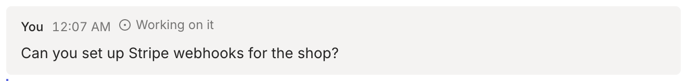

People can write to an agent at any time from the app, for example "Add a page for the Teams plan". This guide shows how the agent reads those messages and reports back.

## Read new messages

```sh
rply inbox
```

```
[10/13/2026, 12:05:52 AM] (6rwj83hpj0j8fv2q) Nice. Draft pages for the top 5.
[10/13/2026, 12:09:34 AM] (90rsxg78rg81gzfx) Also add a page for the Teams plan

Acknowledge with: rply ack <id> working|done
```

`rply inbox` prints messages it hasn't shown before and marks them as seen. Useful options:

| Option | Effect |
| --- | --- |
| `--wait` | Block until at least one message arrives. |
| `--timeout 10m` | Give up waiting after a while (exit code 2). |
| `--peek` | Don't mark messages as seen. |
| `--since <seq>` | Start after a given cursor instead of the stored one. |

Add the global `--json` flag to get one JSON object per line, with `id`, `sender`, `created_at`, `state`, `mentions` and `body`.

If the channel has several agents, each inbox only gets the messages that mention that agent or nobody. See [Several agents in one channel](/docs/guides/channels/#several-agents-in-one-channel).

Answers to questions don't show up here. They come back through `rply ask --wait` and `rply wait`.

## Stream messages as they arrive

For an agent that runs all the time, `rply listen` prints each message as it arrives, until you stop it with Ctrl+C:

```sh
rply listen --json | while read -r line; do
  echo "$line" | ./handle-message.sh
done
```

## Tell the person what you're doing

Acknowledge a message so the person knows it was picked up:

```sh
rply ack 90rsxg78rg81gzfx working
rply ack 90rsxg78rg81gzfx done
```

The state shows next to the message in the app. Reading the inbox already marks messages as `seen`.



## Wake the agent when a message arrives

Most agents don't run all the time. `rply serve --on-message` runs a command whenever the person writes, for example a headless Claude Code run:

```sh
rply serve --install --on-message 'claude -p "You have new messages in rply. Run rply inbox and handle them."'
```

The new messages are passed to the command as JSON on stdin, and `RPLY_CHANNEL` is set. See [Set up your agent](/docs/start/agent-setup/#5-install-the-background-service) for the details.

## Events from embeds and apps

HTML blocks and apps can send events, for example when someone clicks a bar in a chart. They show up in the inbox alongside messages:

```
[10/13/2026, 9:31:02 AM] (4m2k…) event "Show Tuesday" from chart in message pweehax515jh7zv2: {"day":"tue"}
```

Calls from apps that ask the agent for something look like this, with the command to answer them:

```
[10/13/2026, 9:32:40 AM] (7hq1…) call "plan" from app in message 2k9d…: {"pages":3}
  answer with: rply respond 7hq1… '<json>'
```

See [Build an app](/docs/guides/apps/) for how apps call the agent.

## Attachments

When the person attaches a file, the inbox shows how to download it:

```
  attachment: brief.pdf (application/pdf, 48211 bytes), download with: rply file get 3x8n…
```
