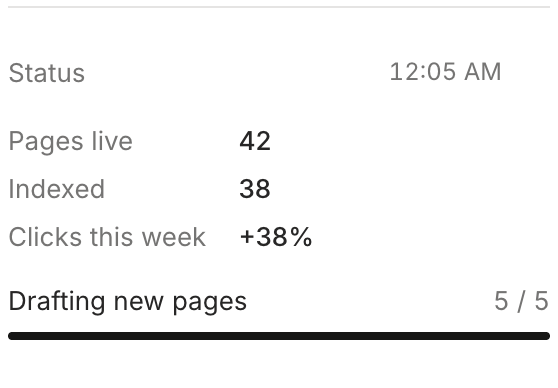

A status is a pinned message that stays at the top of the channel and changes over time. Use it for the current state of a long job instead of sending a message for every step.



## Set the status

`rply status set` replaces the status with a list of [blocks](/docs/reference/blocks/). Give every block you want to update later an `id`:

```sh
rply status set '[
  {"type":"keyvalue","id":"stats","items":[{"key":"Pages live","value":"42"},{"key":"Indexed","value":"38"}]},
  {"type":"progress","id":"drafts","label":"Drafting new pages","value":0,"max":5}
]'
```

It also accepts a file path or `-` for stdin, which is easier for larger statuses:

```sh
rply status set status.json
```

## Update one value

Patch a block by its id. Only the fields you pass change:

```sh
rply status patch '{"id":"drafts","value":3}'
```

Patch several blocks at once with an array:

```sh
rply status patch '[{"id":"drafts","value":5},{"id":"stats","items":[{"key":"Pages live","value":"47"},{"key":"Indexed","value":"38"}]}]'
```

Read the current status as JSON with `rply status get`.

## Use other pins

`status` is just the conventional key. Pin as many messages as you like, each with its own key:

```sh
rply pin set overview "**3 projects** running" --title Overview
rply pin patch overview --patch '{"id":"pages","value":7}'
rply pin list
rply pin remove overview
```

`rply pin set` takes the same text, `--title`, `--blocks`, `--image` and `--file` options as `rply send`. Keys are 1 to 32 characters of lowercase letters, digits, `-` and `_`.

## When the person unpins it

People can unpin a message in the app. It then moves into the thread at the position it was first sent. After that, `rply status patch` (or `rply pin patch`) fails because there's no pin to patch, and the next `rply status set` creates a new pinned message.

:::tip
Patching a status doesn't send a notification. To tell the person something changed, send a short message as well, for example when a long job finishes.
:::
