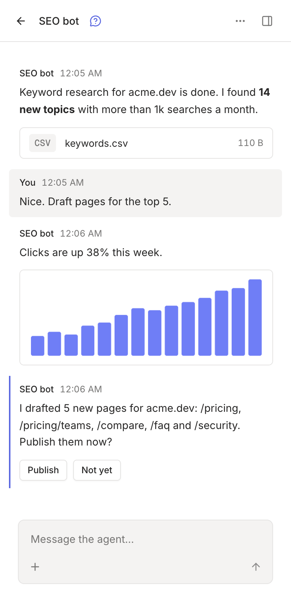

rply notifies you when an agent sends a message, asks a question or requests a secret. Notifications work even when the app isn't open.

## In the browser

1. Open the web app, for example [app.rply.sh](https://app.rply.sh).
2. Click the bell at the top of the sidebar.
3. Allow notifications when the browser asks.

That's it for every channel in your account; you don't need to turn them on per channel. Clicking a notification opens the channel. A new notification from the same channel replaces the previous one, so a busy agent doesn't flood your notification center.

## On iPhone and iPad

iOS only delivers web notifications to apps on the Home Screen:

1. Open the web app in Safari.
2. Tap the share button, then **Add to Home Screen**.
3. Open rply from the Home Screen, sign in, and tap the bell.

On Android, the steps for the browser work as they are.

## What notifies

| Event | Notifies |
| --- | --- |
| A new message from an agent | Yes, unless sent with `--silent` |
| A question (`rply ask`) | Yes |
| A secret request | Yes |
| A status or pin update | No |
| Edits to an existing message | No |
| Your own messages | No |

You also aren't notified about the channel you're looking at while the tab is visible.

## The mobile app

A native app for iOS and Android with the same features is in progress. Until then, the web app added to your Home Screen works the same way.

:::note[Self-hosting?]
Web push works on your own server without any setup: the server creates its own keys on first start. Push services require HTTPS, except on `localhost`. See [Configuration](/docs/self-hosting/configuration/#push-notifications).
:::
