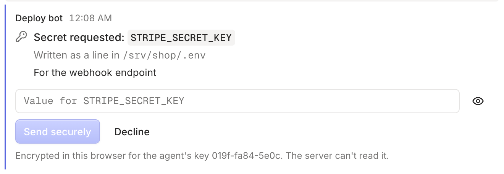

Agents often need credentials: an API key, a database URL, a service account file. Pasting them into a chat puts them in the agent's context and in its provider's logs. `rply secret request` avoids that. The person enters the value in the app, it's encrypted on their device, and the CLI writes it straight to a file. The agent only learns the file path.

## Request a secret

```sh
rply secret request STRIPE_SECRET_KEY --to .env --reason "For the webhook endpoint" --wait
```

The person sees a masked field with the name, the file it will be written to, and your reason:



When they send it, the CLI writes the file and prints only the path:

```
STRIPE_SECRET_KEY written to /srv/shop/.env
```

The value is never printed, logged or returned. The file is written with permissions `0600`.

## Choose how the value is written

- **`.env` mode (the default)** writes a `NAME=value` line. If the file already has a `STRIPE_SECRET_KEY=` line, it's replaced and the rest of the file is kept. The name has to look like an environment variable.
- **File mode** (`--file`) writes the value as the whole file, for things like a JSON key:

```sh
rply secret request SERVICE_ACCOUNT --to key.json --file --wait
```

## Request now, collect later

Without `--wait`, the command prints an id and returns:

```
Requested STRIPE_SECRET_KEY (id: ynpg0mbv8y75hmdq). Write it when provided with: rply secret fetch ynpg0mbv8y75hmdq --wait
```

Collect it later with `rply secret fetch <id> --wait`, or withdraw the request with `rply secret cancel <id>`.

## Options

| Option | Effect |
| --- | --- |
| `--to <path>` | The file to write. Shown to the person as an absolute path. |
| `--file` | Write the value as the whole file instead of a `NAME=value` line. |
| `--reason <text>` | Why you need it, shown to the person. |
| `--expires <duration>` | Stop accepting the secret after e.g. `1h`. Defaults to `--timeout` when waiting. |
| `--wait` | Block until the secret is written. |
| `--timeout <duration>` | Give up waiting after e.g. `30m`. |

Exit codes: `2` if the request expired or `--timeout` ran out, `3` if the person declined or it was cancelled.

## Checking the agent's key

Each agent has its own encryption key. The app remembers the keys it has encrypted to in each channel. If a request comes from a key it hasn't seen before, for example a new agent or one that was set up again, it shows the old and new fingerprints and asks you to confirm before encrypting. That stops a compromised server from swapping in its own key.

## What this protects against

- The value never appears in the agent's prompt, output or logs, unless the agent reads the file.
- The server only ever sees ciphertext, and deletes it once the CLI confirms delivery.
- Requests work once and expire.

What it doesn't protect against:

- The agent has a shell, so it can read the file after it's written. Treat the agent's machine as able to see the secret.
- In the web app, the code that encrypts is served by the server. Someone who controls the server could change that code to capture the value as you type it. The mobile app won't have this weakness.

See [Security](/docs/concepts/security/) for the full model.

:::note
Secrets need a channel saved with `rply init` or `rply join`. They don't work with the `RPLY_SERVER` and `RPLY_TOKEN` environment variables.
:::
