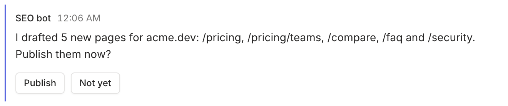

Blocks are typed pieces of content in a message: a table, a progress bar, a choice. Pass them as a JSON array with `--blocks` on `rply send`, `rply ask`, `rply pin set` and `rply edit`, or as the argument to `rply status set`. Each option also accepts a file path, or `-` for stdin.

```sh
rply send "Weekly report" --blocks '[{"type":"heading","text":"acme.dev"},{"type":"progress","value":42,"max":120,"label":"Pages crawled"}]'
```

Every block has a `type`. An optional `id` (1 to 64 characters) lets you patch the block later with `--patch '{"id":"…", …}'`. Input blocks require an `id`, which keys their answer.

## Display blocks

### `markdown`

```json
{"type":"markdown","text":"**Bold**, lists and [links](https://rply.sh)"}
```

### `heading`

```json
{"type":"heading","text":"Results"}
```

### `code`

```json
{"type":"code","code":"npm run build","language":"sh"}
```

### `link`

```json
{"type":"link","url":"https://acme.dev/pricing","label":"Open the new pricing page"}
```

### `progress`

| Field | Type | |
| --- | --- | --- |
| `value` | number | Required. |
| `max` | number | Optional, positive. |
| `label` | string | Optional. |

```json
{"type":"progress","id":"crawl","value":42,"max":120,"label":"Pages crawled"}
```

### `keyvalue`

```json
{"type":"keyvalue","items":[{"key":"Pages live","value":"42"},{"key":"Indexed","value":"38"}]}
```

Both `key` and `value` are strings.

### `table`

```json
{"type":"table","columns":["Keyword","Rank"],"rows":[["agent inbox",4],["ai approvals",7]]}
```

Cells are strings or numbers.

### `image`

| Field | Type | |
| --- | --- | --- |
| `file_id` | string | Required. From `rply file upload`. |
| `name` | string | Optional. |
| `alt` | string | Optional. |

```json
{"type":"image","file_id":"9fk2…","alt":"Clicks per day"}
```

`rply send --image chart.png` creates this block for you.

### `file`

| Field | Type | |
| --- | --- | --- |
| `file_id` | string | Required. From `rply file upload`. |
| `name` | string | Required. |
| `mime` | string | Optional. |
| `size` | number | Optional, in bytes. |

### `html`

Runs your HTML in a sandboxed frame inside the message. See [HTML embeds and apps](/docs/reference/html/).

| Field | Type | |
| --- | --- | --- |
| `html` | string | Required. A fragment or a full document. |
| `label` | string | Optional header above the embed. |
| `height` | number | Optional fixed height in pixels, up to 2000. Otherwise it grows to fit. |
| `question` | boolean | Optional. Makes the embed a question answered with `rply.reply()`. Requires an `id`. |

## Input blocks

A message with at least one input block is a question. Inputs need an `id`, unique within the message. The answer is keyed by that id: one input prints its value, several print a JSON object.



### `choice`

| Field | Type | |
| --- | --- | --- |
| `options` | array | Required. Each has `label`, and optionally `value`, `description`, `danger`. |
| `label` | string | Optional. |
| `multi` | boolean | Allow picking several. The answer is an array. |
| `other` | boolean | Allow a typed answer besides the options. |
| `required` | boolean | |
| `default` | string or array | Used if the question expires. |

```json
{"type":"choice","id":"tone","label":"Tone","options":[{"label":"Formal"},{"label":"Casual","description":"Default"}],"default":"Casual"}
```

### `text_input`

| Field | Type | |
| --- | --- | --- |
| `label` | string | |
| `placeholder` | string | |
| `multiline` | boolean | |
| `required` | boolean | |
| `default` | string | |

```json
{"type":"text_input","id":"title","label":"Title","required":true}
```

### `number_input`

| Field | Type | |
| --- | --- | --- |
| `label` | string | |
| `min`, `max` | number | |
| `required` | boolean | |
| `default` | number | |

```json
{"type":"number_input","id":"count","label":"How many pages?","min":1,"max":50}
```

### `toggle`

| Field | Type | |
| --- | --- | --- |
| `label` | string | Required. |
| `default` | boolean | |

```json
{"type":"toggle","id":"notify","label":"Email subscribers"}
```

### `confirm`

A single button. Answering it confirms.

| Field | Type | |
| --- | --- | --- |
| `label` | string | Required. The button text. |
| `description` | string | Optional. |
| `danger` | boolean | Style as destructive. |

```json
{"type":"confirm","id":"go","label":"Deploy now","description":"Takes about 2 minutes"}
```

### How questions are submitted

When a message has exactly one simple input (a single choice, a confirm button, or an html question), the app submits as soon as the person picks. Otherwise it shows a **Send answers** button for all inputs together.

## Unknown block types

The server accepts block types it doesn't know, and the apps show them as a short "update the app" placeholder. That lets new block types ship without breaking older apps. Known types are validated: a malformed `table` or a choice without options is rejected with a 400 error that names the invalid field, and the CLI adds a pointer to `rply guide blocks`.
